# Praece Render App Template

Build a working web app by describing it in plain language. This template gives you a
ready-to-run app (login, admin, database) that lives on [Render](https://render.com), and a
setup where [Claude Code](https://claude.ai/code) builds and ships every change you ask for.

You set things up once (about 30 minutes), with Claude doing the technical parts. After that, you open Claude, describe what you
want, and Claude builds it and puts it live.

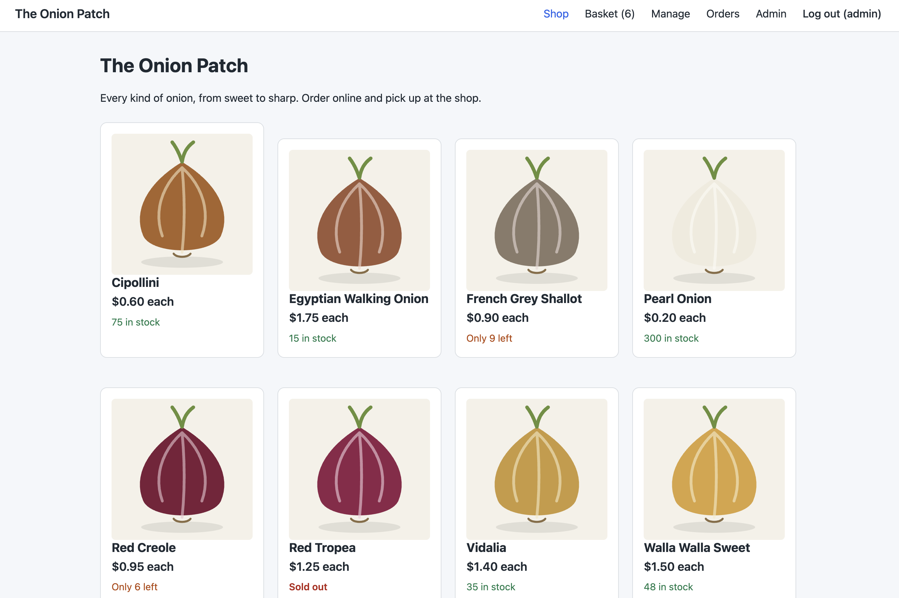

*An example: an online shop built from this template by describing it to Claude.*

---

## What you'll need

- **A GitHub account.** GitHub stores your app's code. [Sign up](https://github.com/signup) if you don't have one.
- **A Render account** with a payment method. Render runs your app and its database.
  Sign up at [render.com](https://render.com) using **Sign in with GitHub**, which saves a step later.
  The app uses Render's paid Starter web service and Basic database plans
  ([pricing](https://render.com/pricing)).
- **A Claude plan that includes Claude Code** (Pro, Max, Team, or Enterprise).
- **Optional: a custom domain** (like `tracker.yourcompany.com`) and access to change its DNS settings.

> **Using a company GitHub organization, Render workspace, or Claude Team/Enterprise plan?**
> This guide assumes accounts you control. In an organization, some steps may need an owner or
> admin to approve them, and company rules can get in the way. If a step doesn't work as described,
> these are the usual places to look:
> - GitHub: [approving apps for an organization](https://docs.github.com/en/apps/using-github-apps/installing-a-github-app-from-a-third-party)
>   (Render and Claude are both GitHub apps), and [rulesets](https://docs.github.com/en/repositories/configuring-branches-and-merges-in-your-repository/managing-rulesets/about-rulesets)
>   that block pushing straight to `main` (Claude ships by pushing to `main`).
> - Render: [connecting GitHub](https://render.com/docs/git-provider) and
>   [workspace roles](https://render.com/docs/team-members).
> - Claude: [Claude Code on the web](https://code.claude.com/docs/en/claude-code-on-the-web).

---

## Step 1: Make your own copy of the template

1. Open this template repository on GitHub.
2. Click **Use this template** → **Create a new repository**.
3. Choose the **Owner** (you or your organization) and a **Repository name**, like `equipment-tracker`.
4. Choose **Private**.
5. Click **Create repository**.

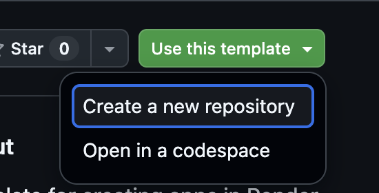

---

## Step 2: Set up Claude Code on the web

Claude Code on the web runs Claude in a private cloud computer that has a copy of your
repository. Claude needs three connections: GitHub (to read and save code), Render (to watch
deploys and read logs), and network access (to install packages and check your live site).

### 2a. Connect GitHub

1. Go to [claude.ai/code](https://claude.ai/code).
2. Follow the prompt to connect GitHub and install the **Claude** GitHub app.
3. Under **Repository access**, choose **Only select repositories** and add your repository.

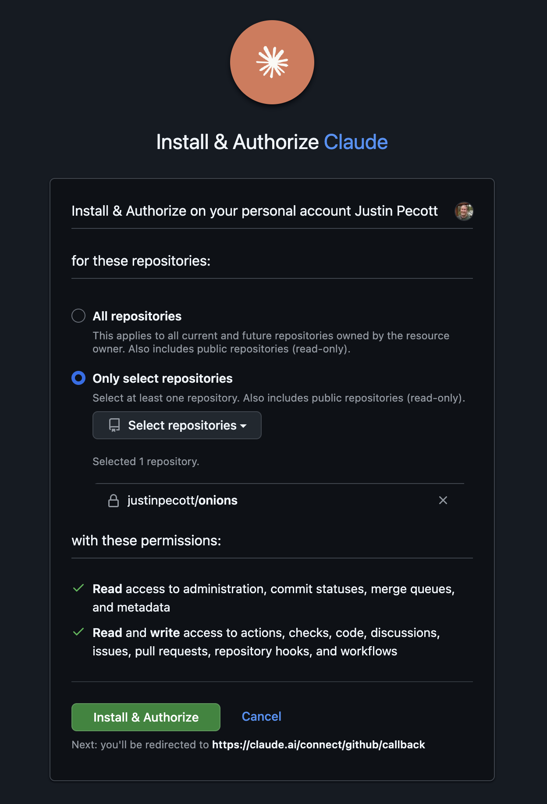

### 2b. Connect Render

1. On [claude.ai](https://claude.ai), open **Settings** → **Connectors**.
2. Find **Render** and click **Connect**. Sign in to Render and approve access.
3. If you belong to more than one Render workspace, Claude will ask which one to use the
   first time; pick the one your app will be in.

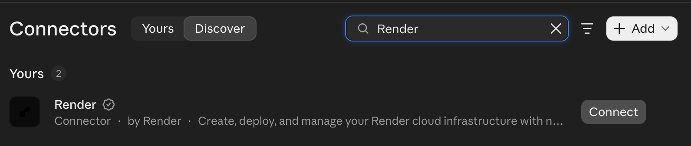

### 2c. Connect the GitHub connector (optional)

In **Settings** → **Connectors**, also connect **GitHub**. This lets Claude look at issues and
pull requests. It isn't required for building and shipping.

### 2d. Create an environment

1. In [claude.ai/code](https://claude.ai/code), click the environment menu (it starts out as
   **Default**) and choose **New environment**.

   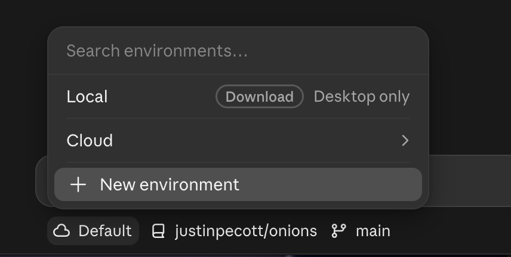

2. Give it a name, like your app's name.
3. Under **Network access**, choose **Limited**. In **Allowed domains**, enter `*.onrender.com`
   (and your custom domain, if you have one, on its own line), and tick **Allow package managers**.
   This lets Claude install what the app needs and check your live site, and nothing else.

   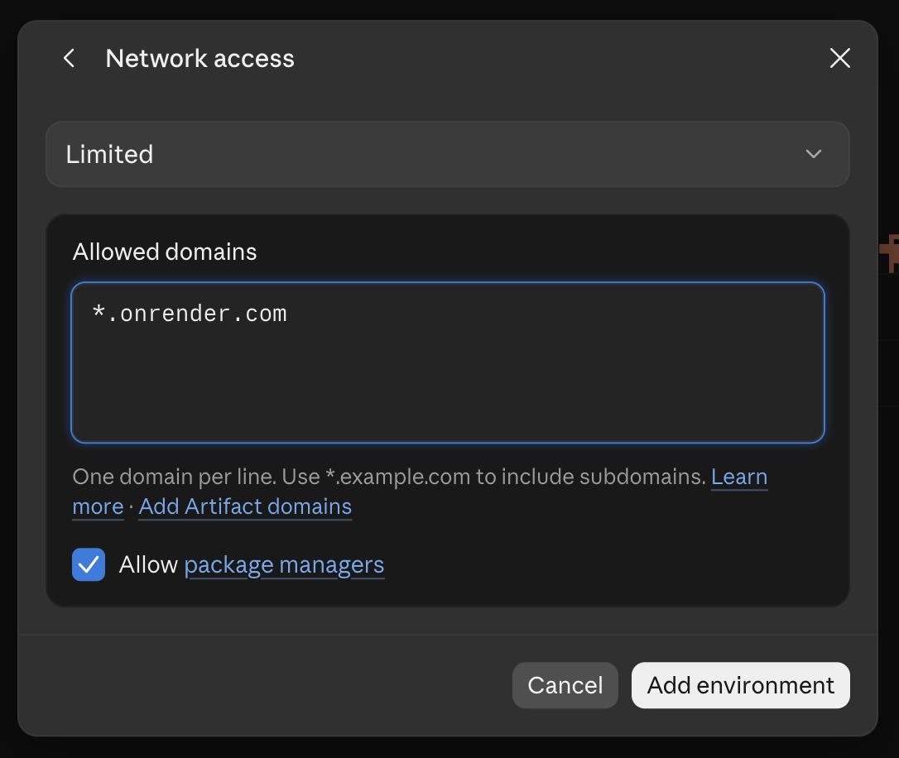

4. Leave environment variables empty. Your app's secrets live in Render, not here.
5. Click **Add environment**.

---

## Step 3: Name your app with Claude

1. In [claude.ai/code](https://claude.ai/code), select your **repository** and **environment**.
2. Type: **Set up this project.**
3. Claude asks what to call your app and suggests a name. The name becomes part of your app's
   web address (like `equipment-tracker.onrender.com`), so pick something you're happy with;
   it's hard to change later.
4. Claude saves the name and tells you to set up Render. **Keep this session open**; you'll come back to it.

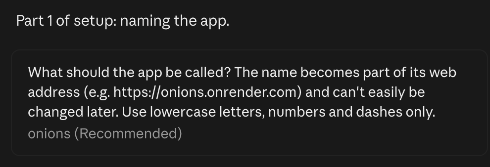

---

## Step 4: Put your app on Render

Render reads the `render.yaml` file Claude just updated and creates everything from it: the web
app, the database, and the connection between them. It also sets up automatic deploys: every
time new code reaches the `main` branch on GitHub, Render rebuilds the app, updates the database
(runs migrations), and switches to the new version only if it starts up healthy.

### 4a. Let Render see your repository

1. In the [Render dashboard](https://dashboard.render.com), click **New** → **Blueprint**.
2. The first time, Render asks you to install its GitHub app. Choose **Only select repositories**,
   pick your repository, and click **Install**.
3. Under **Connect a repository**, find your repository.
   - If it's not listed, click **Configure GitHub** (or **Configure account**). On GitHub,
     under **Repository access**, add your repository and click **Save**.

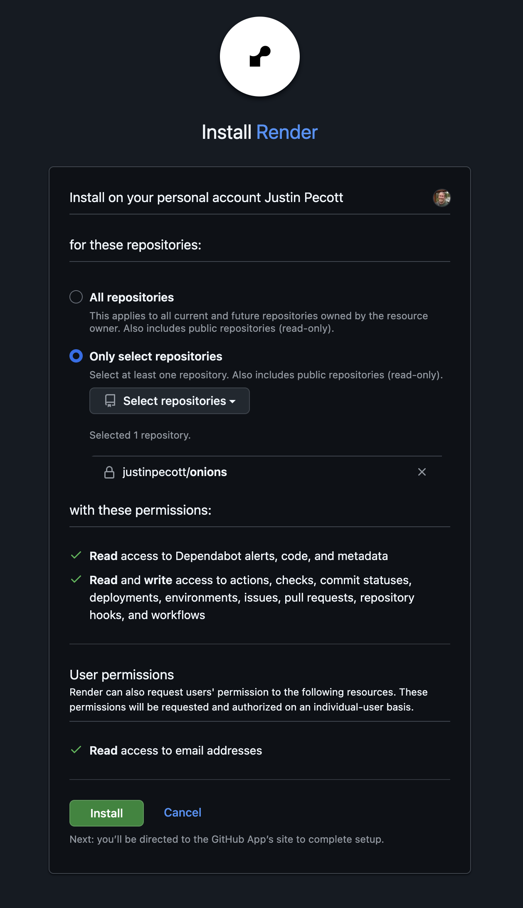

### 4b. Create the Blueprint

1. Click **Connect** next to your repository.
2. Give the Blueprint a name (your app's name is fine). Leave the branch as `main`.
3. Render lists what it will create: a web service and a PostgreSQL database with the name you
   chose in Step 3. If it still says `my-app`, go back to Claude: the name wasn't saved yet.
4. Click **Deploy Blueprint**.

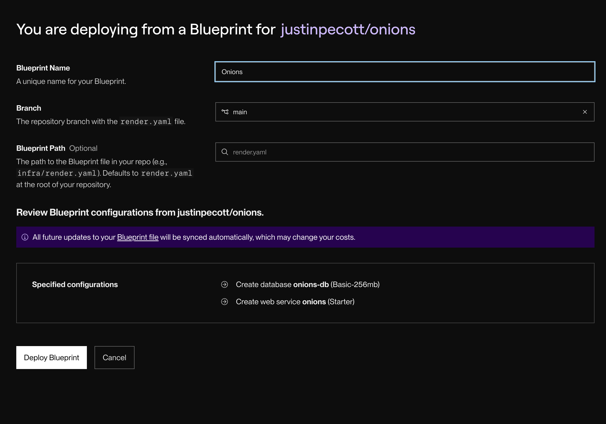

### 4c. Watch the first deploy

1. Open your web service in the dashboard. Under **Events**, the first deploy runs through
   **build**, **pre-deploy** (this is where database migrations run), and **deploy**. This takes a few minutes.
2. When it says **Live**, click the `https://<your-app>.onrender.com` link at the top of the page.
   You should see a login page. You don't have an account yet; Claude creates one in Step 5.

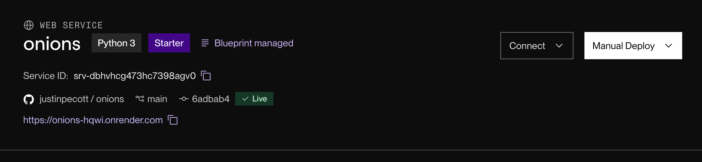

### 4d. Check automatic deploys and migrations are on

These come from `render.yaml`, so they should already be set. To confirm, open the web
service's **Settings** and check, in the **Deploy** section:

- **Auto-Deploy**: **On Commit**.
- **Pre-Deploy Command**: includes `manage.py migrate`.

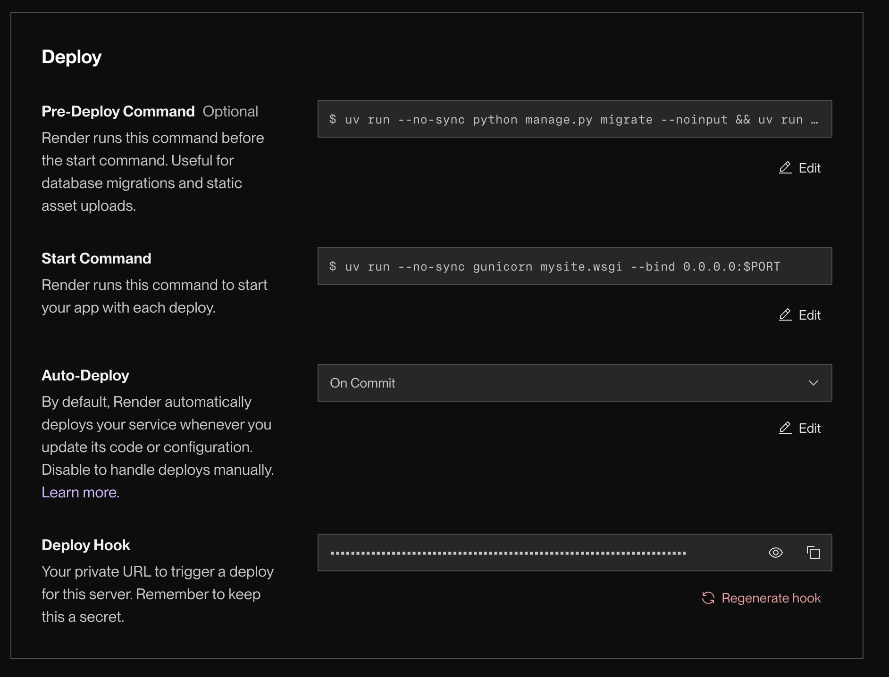

Further down the same Settings page, **Health Check Path** should be `/health/`.

---

## Step 5: Finish setup with Claude

1. Go back to your Claude session from Step 3 and type: **Render is ready.**
2. Claude will:
   - find your app on Render and record its name and address,
   - create your admin account and redeploy,
   - give you the **web address**, **username** (`admin`), and **password**.
3. **Save the password in a password manager.** Claude shows it only once.
4. Open the web address, log in, then go to **Admin** → **Change password** (top right) and
   choose your own.

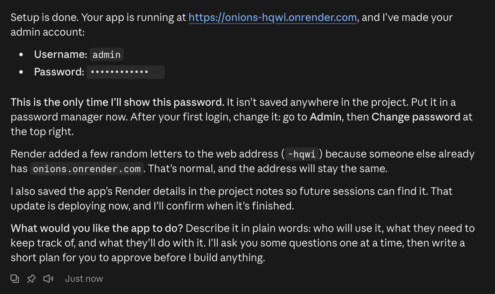

You can add more people in **Admin** → **Users** → **Add user**. Tick **Staff status** for anyone
who should be able to use the admin.

---

## Step 6: Describe your app

Start a new session and tell Claude what you want, in your own words:

> We need to track our equipment: name, serial number, where it's installed, and when it was last
> serviced. Show me what's overdue for maintenance on the home page.

**Claude asks before it builds.** For a new app or a big feature, Claude interviews you first,
one question at a time, usually with answers you can click. It asks who uses the app, what it
keeps track of, what people do with it, and who can see and change what. Then it writes up a
short plan for you to approve and builds the first piece. For smaller changes it asks a quick
question or two, and small fixes it just does. If you want it to skip the questions, say "just do it".

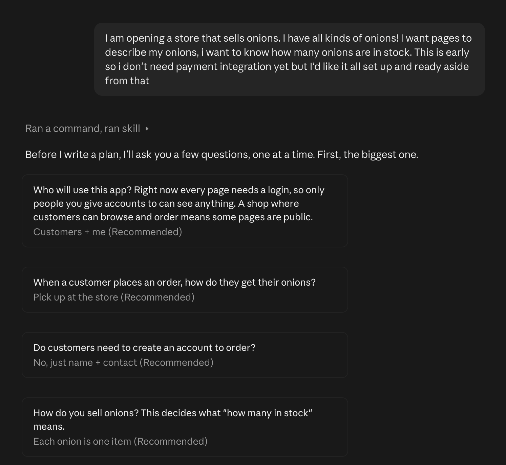

You can start the full interview yourself at any time by typing **`/grill-me`**.

Each time, Claude makes the change, saves it to GitHub, waits for Render to deploy it, checks the
live site, and tells you what changed and where to look.

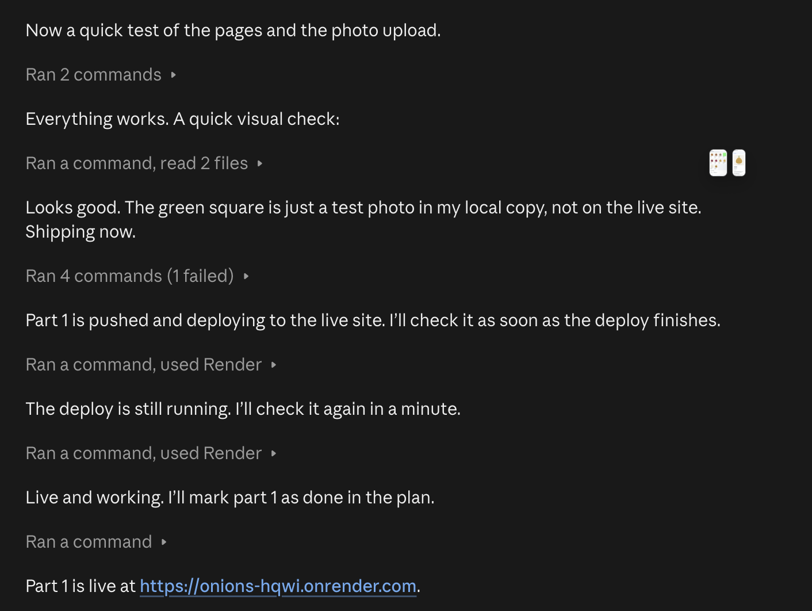

### Tips

- **Ask for one thing at a time.** Small steps are easier to check and easier to undo.
- **Look at the live site after each change** and say what's wrong in plain words
  ("the date column is empty", "I expected this to be on the home page").
- **Use fake data.** The app is a prototype; never enter real customer information.
- **Claude will ask before deleting data.** If a change would remove information from the
  database, Claude explains what would be lost and waits for your yes.

---

## Using your own domain (optional)

Your app works at its `onrender.com` address. To use your own, like `tracker.yourcompany.com`:

1. Tell Claude: **Use tracker.yourcompany.com for this app.** Claude updates the app and tells you
   the DNS record to add.
2. Add that record (usually a **CNAME** pointing at your `onrender.com` address) wherever your
   domain's DNS is managed.
3. In Render, open the web service → **Settings** → **Custom Domains** and wait for the domain to
   show **Verified** and the certificate as issued.

---

## Troubleshooting

**A deploy failed.** Ask Claude: "The last deploy failed. Check the logs and fix it."

**The live site shows an error.** Tell Claude what you did and what you saw. Claude reads
Render's logs to find the cause.

**Claude says it can't reach Render.** Reconnect Render in claude.ai **Settings** → **Connectors**,
then start a new session.

**Forgot the admin password.** Another staff user can reset it in **Admin** → **Users**. If nobody
can log in, open the web service in Render, click **Shell**, and run:

```sh
uv run python manage.py changepassword admin
```

---

## For developers

Django 6.1, Python 3.14, Postgres 18, deployed with a Render Blueprint (`render.yaml`).
Project rules for Claude are in `CLAUDE.md`.

### Running locally

```sh
uv sync
uv run python manage.py migrate
uv run python manage.py runserver
```

Without `DATABASE_URL` set, the app uses a local SQLite file (`db.sqlite3`).
On Render, migrations run automatically in the pre-deploy step. See `.env.example` for
all environment variables.

Lint and format: `uv run ruff check --fix . && uv run ruff format .`

### What's where

| Path | What it is |
|---|---|
| `render.yaml` | Render Blueprint: web service, database, build/pre-deploy/start commands |
| `CLAUDE.md` | Instructions Claude follows in every session |
| `.claude/skills/grill-me/` | The `/grill-me` planning interview |
| `docs/` | Created by Claude: the app brief and plans for big features |
| `mysite/settings.py` | Django settings (Render detection, database, allowed hosts) |
| `mysite/views.py` | Home page and `/health/` (used by Render's health check) |
| `mysite/management/commands/ensure_superuser.py` | Creates the first admin on deploy |
| `mysite/management/commands/wait_for_db.py` | Waits for the database before migrations run |
| `templates/` | Shared layout (`base.html`), login, and home page |
| `static/css/site.css` | Site styles |
